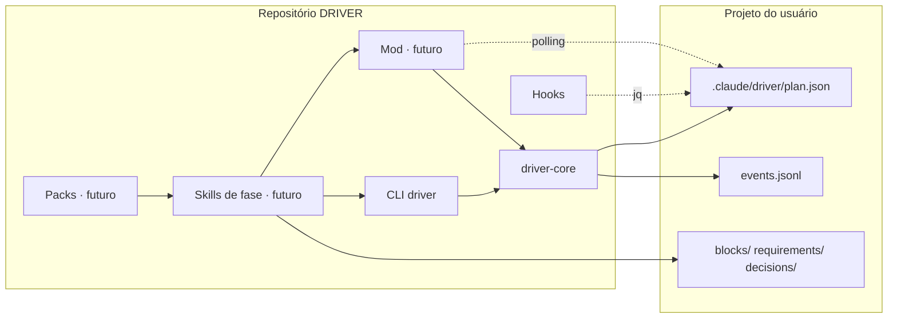

# Arquitetura — DRIVER

## Visão geral
DRIVER é um marketplace de plugins de Claude Code. O core `driver` impõe o método Discover · Route · Implement · Validate · Evolve · Release sobre um projeto do usuário; packs de domínio (`driver-web`, `driver-mobile`, `driver-finance`, `driver-social`, `driver-video`) acrescentam perguntas, provedores, validadores e checklists. O artefato central é o grafo de plano em `.claude/driver/plan.json` dentro do projeto do usuário (ADR-002, ADR-009, ADR-010). Tudo o mais lê ou escreve esse arquivo.

## Componentes

### No repositório do DRIVER
- **`driver-core` (`plugins/driver/src/`)**: biblioteca TypeScript com o schema zod (`schema.ts`), validador de invariantes (`validate.ts`), reducer puro de mutações (`reducer.ts`), máquina de estados e revogação de gates (`state-machine.ts`), adaptador de I/O com lock e rename atômico (`store.ts`), alocação de ids (`ids.ts`) e exportador Mermaid (`mermaid.ts`).
- **CLI `driver` (`src/cli.ts` → `dist/cli.js`)**: única porta de escrita do `plan.json` na v1. Comandos: `init · validate · block add|set · req add · gate approve|revoke · phase advance|back · rebaseline · export mermaid · renumber`. Bundle único commitado para os hooks não dependerem de build.
- **Hooks (`plugins/driver/hooks/`)**: `PreToolUse` em `Agent|Task|Workflow` (gate por fase, via `jq`), `PreToolUse` em `Edit|Write|Bash` (protege `plan.json` e bloqueia `driver approve` vindo do modelo), `SubagentStop` (bloco órfão vira `blocked`).
- **Mod (futuro, `plugins/driver/mods/`)**: painel ao lado do chat que espelha `plan.json` em `$.state` e desenha SVG (Desktop/VS Code) ou Box/Text (terminal). Registra `mcp__driver__set_block_state` e `mcp__driver__plan_ops`, que chamam o mesmo `driver-core`.
- **Skills de fase (futuro, `plugins/driver/skills/`)**: Discover, Route, Implement, Validate, Evolve, Release. Compõem skills externas pinadas (ADR-003) e escrevem no plano via tool ou CLI.
- **Packs (futuro, `plugins/driver-*/`)**: plugins separados no mesmo marketplace, dependentes do core. Dados extras em `ext['driver-<pack>']`.

### No projeto do usuário (`.claude/driver/`)
`plan.json` (snapshot canônico) · `events.jsonl` (ledger) · `log/REL-n.jsonl` · `blocks/B-xxx.md` · `requirements/R-xxx.md` · `decisions/D-xxx.md` · `discover/` · `exports/` (gitignored) · `.lock/` (gitignored).

## Fluxo de dados

```
usuário ──/driver approve──▶ CLI ─┐
skill de fase ──tool/CLI────────▶ │ driver-core: lock → ler → reducer → validar → .tmp+rename → evento
subagent (resultado) ─▶ orquestrador ─▶ │
                                   └──▶ .claude/driver/plan.json + events.jsonl
                                              │              │
                        hook PreToolUse (jq) ◀┘              └▶ mod (polling 1 s, redesenha se revision mudou)
                                                                 exportador Mermaid (exports/plan.mmd)
```

Regras: um escritor (o processo que segura o lock); raiz resolvida pelo worktree principal via `git rev-parse --git-common-dir`; branches de worktree nunca tocam `plan.json`; `revision` sobe a cada escrita, `baseline` a cada re-baseline do Evolve.

## Integrações externas
- Claude Code CLI ≥ 2.1.287 (mods) e sistema de plugins com `dependencies` semver (ADR-003).
- Plugins pinados como dependência: superpowers, feature-dev, code-review (quando as skills de fase existirem).
- Provedores de domínio (Vercel, Supabase, Resend, HyperFrames, ElevenLabs...) só via registro de capacidades, por bloco (ADR-004). O core não conhece provedores.

## Diagrama


