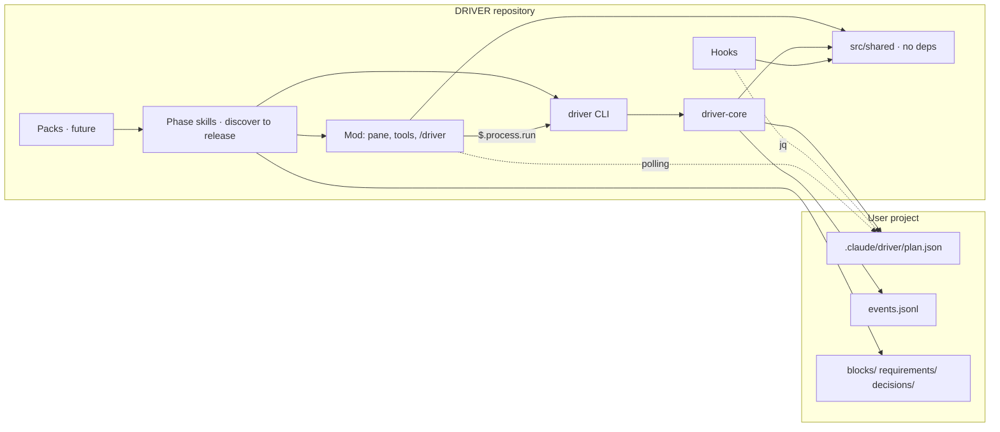

# Architecture · DRIVER

## Overview
DRIVER is a Claude Code plugin marketplace. The `driver` core enforces the Discover · Route · Implement · Validate · Evolve · Release method on a user's project; domain packs (`driver-web`, `driver-mobile`, `driver-finance`, `driver-social`, `driver-video`) add questions, providers, validators and checklists. The central artifact is the plan graph in `.claude/driver/plan.json` inside the user's project (ADR-002, ADR-009, ADR-010). Everything else reads or writes that file.

## Components

### In the DRIVER repository
- **`driver-core` (`plugins/driver/src/`)**: TypeScript library with the zod schema (`schema.ts`), invariant validator (`validate.ts`), pure mutation reducer (`reducer.ts`), state machine and gate revocation (`state-machine.ts`), I/O adapter with lock and atomic rename (`store.ts`), id allocation (`ids.ts`) and Mermaid exporter (`mermaid.ts`).
- **`driver` CLI (`src/cli.ts` → `dist/cli.js`)**: the only write door to `plan.json`. Commands: `init · where · status · validate [--replay] · apply (atomic batch via stdin) · block add|set|status|owner|retire|doc · req add|retire|doc · discover log|show · decision add · gate approve|revoke · phase advance|back · rebaseline · release add · export mermaid · renumber`. `gate approve`, `rebaseline` and `--force` require a TTY or, through the mod, `--via-mod` with a ticket. Single committed bundle so the hooks do not depend on a build.
- **Hooks (`plugins/driver/hooks/`)**: `PreToolUse` on `Agent|Task|Workflow` (gate by phase, via `jq`), `PreToolUse` on `Edit|Write|Bash` (protects `plan.json` and blocks `driver approve` coming from the model), `SubagentStop` (orphan block becomes `blocked`).
- **Dependency-free shared code (`src/shared/`)**: phases, palette, `PlanView` projection, gate verdict, protection rules, swimlane layout, SVG and terminal lines. It is the only part of the core the mod can import (the mod has no Node or zod); node code imports from here too, so the shell hook and the mod apply the same rules (ADR-011).
- **Mod (`plugins/driver/mod/`)**: panel beside the chat that reads `plan.json` by polling (`$.fs`, 1 s), projects into `$.state` and draws a vertical SVG at the panel width (Desktop/VS Code, `mod/render-svg.tsx`), a card board (mobile, `mod/render-board.tsx`) or Box/Text lines (terminal, `mod/render-terminal.tsx`); block selection through `Select`/`Input` in the bar, because clicks on the SVG do not reach the plugin. It registers the tools `mcp__driver__set_block_state`, `plan_ops`, `plan_status` and, since ADR-013, three silent logging tools that do not touch `plan.json`: `discover_log` (interview in `discover/interview.jsonl`, with generated `interview.md`, `assumptions.md` and `non-goals.md`), `block_doc` (sections of `blocks/B-nnn.md`) and `req_doc` (sections of `requirements/R-nnn.md`); and the `/driver` command. Calls coming from a subagent are refused, except `plan_status`, reading `discover_log`, and `set_block_state`/`block_doc` on the block the subagent owns. It always writes through the CLI (`$.process.run`). Hooks: `agent.spawn` (gate + owner claim, including Workflow agents), `classic.SubagentStop`, `tool.call` guard. `/driver approve <gate>` only with origin `composer` (or the panel button) and a one-shot ticket with a hash: the model-proof approval channel.
- **Phase skills (`plugins/driver/skills/`)**: all six exist: `discover` and `route` (ADR-012), `implement`, `validate`, `evolve` and `release` (ADR-016, ADR-017). Every change after the route gate goes through the triage in `plugins/driver/references/triage.md` (a fix sends the originating block back to rework, an adjustment becomes a new block marked as after-baseline, a scope change is a question with three outcomes). Validate writes one report per validation block, Evolve writes the cycle review and points to the baseline and gate buttons, Release records the delivery and closes with the next-cycle backlog. Native plugin skills (`SKILL.md` with frontmatter, `user-invocable: true`, slash `/driver:discover` and `/driver:route`), text in English, interview in the user's language via `AskUserQuestion`. Shared conventions (tools, the `"$n"` rule, reducer preconditions, file formats, hard rules) in `plugins/driver/references/driver-conventions.md`, outside `skills/` so it is not scanned as a skill. They write to the plan only through the `mcp__driver__*` tools (fallback: CLI). Discover records the decision tree in `discover/interview.md` at every answer and sends a single batch of `req.add`/`decision.add` at the end; Route creates blocks with `block.add` in a batch, fills `blocks/B-nnn.md` and `route/risks.md`, validates the diagram with the user and advances the phase. External skills (superpowers) are optional support, invoked only if installed (ADR-017).
- **Packs (future, `plugins/driver-*/`)**: separate plugins in the same marketplace, dependent on the core. Extra data in `ext['driver-<pack>']`.

### In the user's project (`.claude/driver/`)
`plan.json` (canonical snapshot) · `events.jsonl` (ledger) · `log/REL-n.jsonl` · `blocks/B-xxx.md` · `requirements/R-xxx.md` · `decisions/D-xxx.md` · `discover/` · `exports/` (gitignored) · `.lock/` (gitignored).

## Data flow

```
user ──/driver approve (composer + ticket)──▶ mod ──▶ CLI ─┐
phase skill ──mcp__driver__* tools / CLI───────────────────▶ │ driver-core: lock → read → reducer → validate → .tmp+rename → event
subagent (result) ─▶ orchestrator ─▶ │
                                   └──▶ .claude/driver/plan.json + events.jsonl
                                              │              │
                        PreToolUse hook (jq) ◀┘              └▶ mod (1 s polling, redraws if revision changed)
                                                                 Mermaid exporter (exports/plan.mmd)
```

Rules: one writer (the process holding the lock); root resolved through the main worktree via `git rev-parse --git-common-dir`; worktree branches never touch `plan.json`; `revision` goes up on every write, `baseline` on every Evolve re-baseline.

## External integrations
- Claude Code CLI ≥ 2.1.287 (mods) and a plugin system with semver `dependencies` (ADR-003).
- No plugin is a hard dependency of the core (ADR-017 revises ADR-003 for the core): superpowers is optional support for the Implement, Validate and Release skills. Packs may pin their own plugins.
- Domain providers (Vercel, Supabase, Resend, HyperFrames, ElevenLabs...) only through the capability registry, per block (ADR-004). The core does not know providers.

## Diagram


