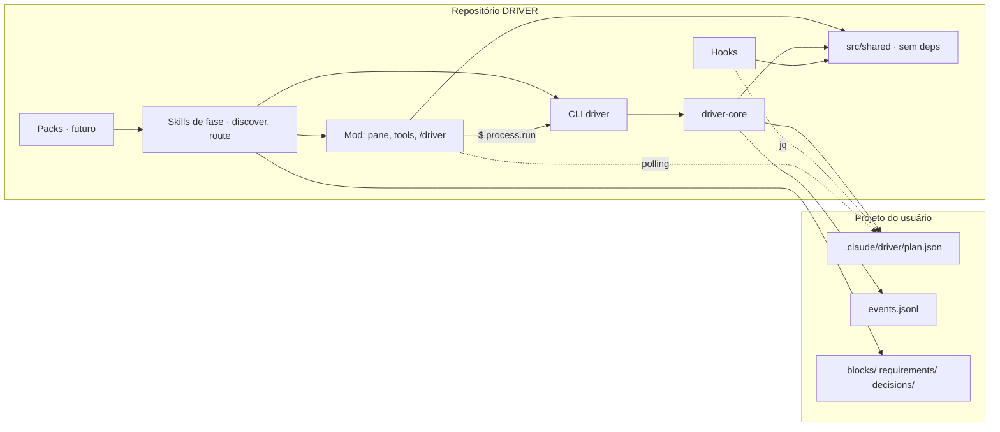

# Arquitetura · DRIVER

## Visão geral
DRIVER é um marketplace de plugins de Claude Code. O core `driver` impõe o método Discover · Route · Implement · Validate · Evolve · Release sobre um projeto do usuário; packs de domínio (`driver-web`, `driver-mobile`, `driver-finance`, `driver-social`, `driver-video`) acrescentam perguntas, provedores, validadores e checklists. O artefato central é o grafo de plano em `.claude/driver/plan.json` dentro do projeto do usuário (ADR-002, ADR-009, ADR-010). Tudo o mais lê ou escreve esse arquivo.

## Componentes

### No repositório do DRIVER
- **`driver-core` (`plugins/driver/src/`)**: biblioteca TypeScript com o schema zod (`schema.ts`), validador de invariantes (`validate.ts`), reducer puro de mutações (`reducer.ts`), máquina de estados e revogação de gates (`state-machine.ts`), adaptador de I/O com lock e rename atômico (`store.ts`), alocação de ids (`ids.ts`) e exportador Mermaid (`mermaid.ts`).
- **CLI `driver` (`src/cli.ts` → `dist/cli.js`)**: única porta de escrita do `plan.json`. Comandos: `init · where · status · validate [--replay] · apply (lote atômico via stdin) · block add|set|status|owner|retire · req add|retire · decision add · gate approve|revoke · phase advance|back · rebaseline · release add · export mermaid · renumber`. `gate approve`, `rebaseline` e `--force` exigem TTY ou, via mod, `--via-mod` com ticket. Bundle único commitado para os hooks não dependerem de build.
- **Hooks (`plugins/driver/hooks/`)**: `PreToolUse` em `Agent|Task|Workflow` (gate por fase, via `jq`), `PreToolUse` em `Edit|Write|Bash` (protege `plan.json` e bloqueia `driver approve` vindo do modelo), `SubagentStop` (bloco órfão vira `blocked`).
- **Código compartilhado sem dependências (`src/shared/`)**: fases, paleta, projeção `PlanView`, veredito de gate, regras de proteção, layout em swimlanes, SVG e linhas do terminal. É a única parte do core que o mod pode importar (o mod não tem Node nem zod); o código node importa daqui também, então hook shell e mod aplicam as mesmas regras (ADR-011).
- **Mod (`plugins/driver/mod/`)**: painel ao lado do chat que lê `plan.json` por polling (`$.fs`, 1 s), projeta em `$.state` e desenha SVG vertical na largura do painel (Desktop/VS Code, `mod/render-svg.tsx`), quadro de cartões (mobile, `mod/render-board.tsx`) ou linhas Box/Text (terminal, `mod/render-terminal.tsx`); seleção de bloco por `Select`/`Input` na barra, porque cliques no SVG não chegam ao plugin. Registra as tools `mcp__driver__set_block_state`, `plan_ops` e `plan_status` e o comando `/driver`. Escreve sempre pela CLI (`$.process.run`). Hooks: `agent.spawn` (gate + claim de owner, inclusive agentes de Workflow), `classic.SubagentStop`, guard `tool.call`. `/driver approve <gate>` só com origem `composer` (ou botão do painel) e ticket one-shot com hash: o canal de aprovação à prova de modelo.
- **Skills de fase (`plugins/driver/skills/`)**: `discover` e `route` existem (ADR-012); Implement, Validate, Evolve e Release são futuro. Skills nativas de plugin (`SKILL.md` com frontmatter, `user-invocable: true`, slash `/driver:discover` e `/driver:route`), texto em inglês, entrevista na língua do usuário via `AskUserQuestion`. Convenções compartilhadas (tools, regra `"$n"`, pré-condições do reducer, formatos de arquivo, regras duras) em `plugins/driver/references/driver-conventions.md`, fora de `skills/` para não ser varrido como skill. Escrevem no plano só pelas tools `mcp__driver__*` (fallback: CLI). Discover grava a árvore de decisões em `discover/interview.md` a cada resposta e manda um lote único de `req.add`/`decision.add` no fim; Route cria blocos com `block.add` em lote, preenche `blocks/B-nnn.md` e `route/risks.md`, valida o diagrama com o usuário e avança a fase. As futuras compõem skills externas pinadas (ADR-003).
- **Packs (futuro, `plugins/driver-*/`)**: plugins separados no mesmo marketplace, dependentes do core. Dados extras em `ext['driver-<pack>']`.

### No projeto do usuário (`.claude/driver/`)
`plan.json` (snapshot canônico) · `events.jsonl` (ledger) · `log/REL-n.jsonl` · `blocks/B-xxx.md` · `requirements/R-xxx.md` · `decisions/D-xxx.md` · `discover/` · `exports/` (gitignored) · `.lock/` (gitignored).

## Fluxo de dados

```
usuário ──/driver approve (composer + ticket)──▶ mod ──▶ CLI ─┐
skill de fase ──tools mcp__driver__* / CLI─────────────────▶ │ driver-core: lock → ler → reducer → validar → .tmp+rename → evento
subagent (resultado) ─▶ orquestrador ─▶ │
                                   └──▶ .claude/driver/plan.json + events.jsonl
                                              │              │
                        hook PreToolUse (jq) ◀┘              └▶ mod (polling 1 s, redesenha se revision mudou)
                                                                 exportador Mermaid (exports/plan.mmd)
```

Regras: um escritor (o processo que segura o lock); raiz resolvida pelo worktree principal via `git rev-parse --git-common-dir`; branches de worktree nunca tocam `plan.json`; `revision` sobe a cada escrita, `baseline` a cada re-baseline do Evolve.

## Integrações externas
- Claude Code CLI ≥ 2.1.287 (mods) e sistema de plugins com `dependencies` semver (ADR-003).
- Plugins pinados como dependência: superpowers, feature-dev, code-review (a partir das skills Implement/Validate/Evolve/Release; Discover e Route não dependem de nenhum, ADR-012 item 4).
- Provedores de domínio (Vercel, Supabase, Resend, HyperFrames, ElevenLabs...) só via registro de capacidades, por bloco (ADR-004). O core não conhece provedores.

## Diagrama


